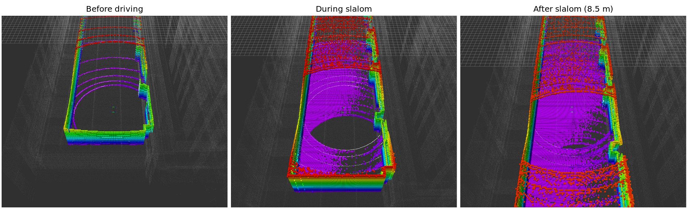
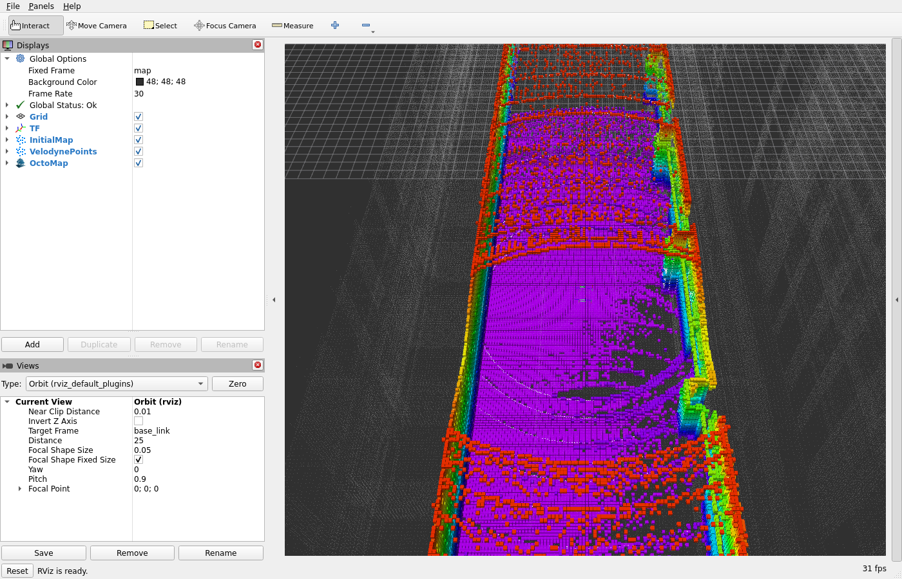
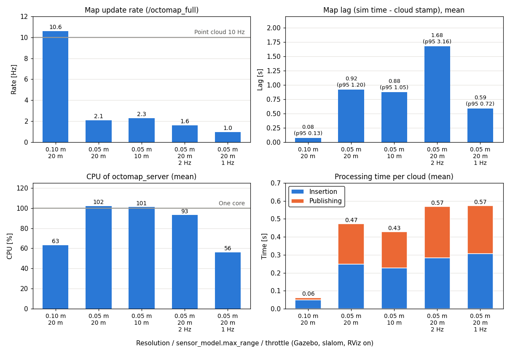
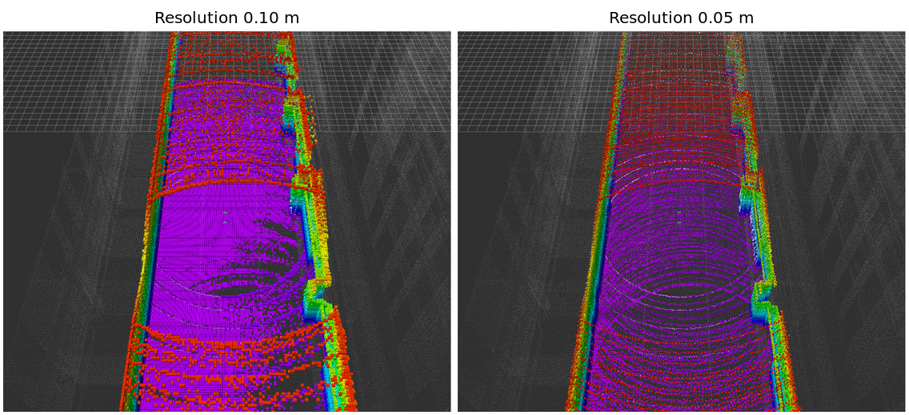

# 開発ログ（octomap）

## 2026-11-17

### 1. 土台を作る

- 目的：Gazebo（`20261002`）と自己位置推定（`test`）の点群・TF から、走りながら OctoMap を作って RViz2 で表示するコンテナを用意する。
- やったこと：
  - `Dockerfile`（`ubuntu:22.04` + ROS 2 Humble の `ros-base`・`rviz2`・`octomap-server`・`octomap-rviz-plugins`・`topic-tools`・`mesa-utils`）、
    `docker-compose.yml`（localization と同じ設定。volumes は X11 と `./config`）、`config/`（launch・`param/gazebo/params.yaml`・RViz）、
    `src/aliases.txt`、`src/fastdds_localhost.xml`（localization から複製）を作った。
  - 入ったパッケージの版：octomap_server 2.3.1、octomap_rviz_plugins 2.1.1、octomap_msgs 2.0.1、liboctomap 1.9.7。
  - `octomap_server_node` を単体で起動し、`ros2 param list`・`describe`・`get` でパラメータ 43 項目（`qos_overrides` を除く）の名前・型・既定値を確かめ、
    `params.yaml` に全項目を書いた。初期値から変えたのは `use_sim_time: true`、`resolution: 0.1`（既定 0.05）、`sensor_model.max_range: 20.0`（既定 -1）、
    `latch: false`（既定 true）。
- 結果（Gazebo と `test` の推定（`env:=gazebo rviz:=false map_path:=.../SC10_4_0.05.pcd`）を起動した状態で）：
  - `octomap` から `/velodyne_points`（frame `velodyne`）・`/tf`（`map` →）・`/tf_static`（`base_footprint` → `base_link` → `velodyne_base_link` → `velodyne`）・
    `/clock` が見え、どれも受信できた（`/tf_static` は transient_local で受ける）。
  - **DDS は 127.0.0.1 の UDP だけ**：`octomap_server`・`rviz2` のソケット（`/proc/<pid>/fd` の inode を `/proc/net/{udp,udp6,tcp,tcp6}` と突き合わせた）は
    各 3 つ（10174・10175 と送信用 1 つ、rviz2 は 10176・10177 と 1 つ）で全部 `127.0.0.1`、TCP なし。ホストの `/proc/net/igmp` で
    239.255.0.1 にはどのインタフェース（lo・enp129s0・docker0）も参加していない。
  - `glxinfo -B`：renderer は `NVIDIA GeForce RTX 5080/PCIe/SSE2`（OpenGL 4.6.0 NVIDIA 595.99.02、direct rendering）。ソフトウェア描画（llvmpipe）ではない。
  - **OpenMP**：`liboctomap.so.1.9.7`（Ubuntu の liboctomap1.9）は libgomp につながっていない（NEEDED は liboctomath・libstdc++・libm・libgcc_s・libc）。
    つまり OctoMap の光線の計算（`computeUpdate`）は 1 スレッドで動く。`octomap_server_node` のプロセスに libgomp が入るのは PCL（`libpcl_common` など）から。
  - 起動時に `Could not open file` の WARN が出るのは、`octomap_path: ""`（読む地図なし）のため。動作には関係ない。

### 2. 走りながら地図を作る（Gazebo、slalom）

- 目的：Gazebo の車椅子を走らせ、OctoMap が積み上がっていくことと、TF を待てずに捨てる点群がほぼ無いことを確かめる。
- やったこと：
  - **QoS**：`ros2 topic info -v /velodyne_points` で、配信（`/velodyne/gazebo_ros_laser_controller`）は RELIABLE・VOLATILE、
    octomap_server の購読は BEST_EFFORT・VOLATILE。RELIABLE の配信を BEST_EFFORT で受けるのは互換なので、中継ノードは要らない。
  - 起動の順：Gazebo（`connection_wheelchair.launch.py`）→ `test` の推定（`env:=gazebo rviz:=false map_path:=.../SC10_4_0.05.pcd`）→ octomap（`rviz:=true`）。
  - 走らせ方：はじめ案 A（`test` の中から `drive gazebo slalom check/octomap_slalom_<日時>`）にしたが、`run_test.sh` は推定を自分で起動・停止する作りで、
    推定が既に動いていると「localization processes are still running」で止まる（走行・録画はしていない）。ユーザーの確認のうえ、
    `test` の中から `drive/drive_test.py gazebo slalom --yes` を直接実行した（推定は上で起動したもの。**録画はしていない**）。
    slalom：1.00 m 前進 → スラローム 12.47 s・7.52 m（sim time 49.6〜63.2 s）。
  - RViz の設定を直した：octomap_rviz_plugins 2.1.1 の `OccupancyGrid` は rviz_common の RosTopicDisplay で、トピックのプロパティ名は `Topic`
    （`Octomap Topic` では「Error subscribing: Empty topic name」で購読しない）。視点は車体（`base_link`）を追う見下ろし（Orbit、距離 25 m、Pitch 0.9、Yaw 0）にした。
- 結果：
  - 走行に沿って地図が積み上がる（下図。左から走る前・走行中・走行後。色は高さ、白は今の点群）。床・壁・天井が 0.1 m のボクセルで埋まる。
  - **MessageFilter**（`Message Filter dropping message`、2.5 s に 1 回までの INFO）：octomap_server は走行中 0 件。起動直後（走る前、sim 41.7 s）に
    「queue is full」が 1 件だけ。rviz2 は「the timestamp on the message is earlier than all the data in the transform cache」が起動直後に 1 件。
    （1 回目の試行では、止まっている間に rviz2 の点群の表示だけ「queue is full」が数件出た。octomap_server は 0 件）

RViz の画面全体（走行後）：

### 3. 解像度・最大距離・点群の間引きを試す（Gazebo、slalom）

- 目的：解像度（0.1 → 0.05 m）、最大距離、点群の間引きで、CPU と、`/octomap_full` の更新が点群（10 Hz）に間に合うかを見る。
- やったこと：
  - 1 回の試行：Gazebo → `test` の推定 → octomap（RViz あり、`log_level:=debug`）を起動し直し（空の地図から）、`drive_test.py gazebo slalom --yes` で走る間の 30 s（壁時計）を測った。
    - 周期・遅れ：octomap コンテナで rclpy のノード（sim time）が `/velodyne_points`・`/octomap_full` を受け、sim time での周期と、遅れ＝受けたときの sim time − 地図の stamp（点群の stamp）を出す。
    - CPU：ホストで `/proc/<pid>/stat` の utime + stime を 1 s ごとに読む（1 コア = 100 %）。
    - 処理時間：octomap_server の DEBUG ログ「Pointcloud insertion ... done」「Map publishing ... took」。
    - 測るための scratch のスクリプトはこのリポジトリに入れていない（構成の外）。
  - launch に引数を 2 つ足した：`log_level`（octomap_server のロガーだけ。既定 info）、`throttle`（既定 false。true なら topic_tools の throttle で
    `/velodyne_points` → `/velodyne_points_throttle` に間引いて octomap_server に渡す。レートは `params.yaml` の `cloud_throttle.msgs_per_sec`）。
    throttle の実行ファイルは種類（`messages`）を最初の位置引数で受け取らないと「Throttle type is missing.」で終わるので、launch が `arguments` で渡す。
- 結果（Gazebo の実時間比はどれも 0.99。点群は 10.5〜11.2 Hz で届く。Gazebo の 1〜3 ms 違いの組のため 10 を少し超える。1 点群 7,040 点）：

| 解像度・最大距離・間引き | 地図の更新 [Hz]（/点群） | 遅れ 平均・p95 [s] | CPU（octomap_server） | 挿入 + 配信 [s/回] | `/octomap_full` 1 通 | CPU（rviz2） |
|---|---|---|---|---|---|---|
| **0.10 m・20 m・なし** | **10.61（1.00）** | **0.08・0.13** | **63 %**（最大 82） | 0.050 + 0.012 | 1.1 MB | 41 % |
| 0.05 m・20 m・なし | 2.10（0.20） | 0.92・1.20 | 102 % | 0.247 + 0.225 | 20.0 MB | 64 % |
| 0.05 m・10 m・なし | 2.29（0.21） | 0.88・1.06 | 101 % | 0.227 + 0.201 | 14.0 MB | 59 % |
| 0.05 m・20 m・2 Hz | 1.61（0.15） | 1.68・3.16 | 93 % | 0.283 + 0.286 | 20.2 MB | 62 % |
| 0.05 m・20 m・1 Hz | 0.98（0.09） | 0.59・0.72 | 56 % | 0.306 + 0.267 | 20.6 MB | 43 % |

  - **0.1 m は点群ごとに地図を更新できる**（1 回 62 ms で 100 ms に収まる）。
  - **0.05 m は 1 コアを使い切り、点群の 8 割を捨てる**。1 回の処理は挿入 約 0.25 s（OpenMP なしの liboctomap で 1 スレッド、項目 1）と
    `/octomap_full` の配信 約 0.23 s（空きも含む地図全体を毎回送る。0.1 m の 18 倍の 20 MB）で、配信の分は地図が広がるほど伸びる。
    MessageFilter の「queue is full」が 2.5 s ごとに出続けた（DEBUG で起動しなかった 1 回目の 0.05 m の試行では、同じく 2.1 Hz なのに 1 件も出なかった。
    捨てた量は MessageFilter のログより、地図の更新数／点群の数で見る）。
  - 最大距離 20 → 10 m はほとんど効かない（挿入 0.247 → 0.227 s）。廊下では、ほとんどの点が 10 m より近い。
  - 間引き 2 Hz は 1 回の処理（0.57 s）が 0.5 s に収まらず、待ちが溜まって遅れがかえって増えた。**1 Hz なら間に合う**（遅れ 0.59 s、CPU 56 %）。
    ただし 1 s に 1 回しか積まないので、0.05 m では床に走査線の輪の模様が残る（下の図の右）。
  - params.yaml は指示の初期値（0.1 m・20 m）のまま。`cloud_throttle.msgs_per_sec` は 0.05 m で間に合う 1.0 にした（`throttle` の既定は false）。

- 歩行者（gazebo_sfm_plugin）の跡：**実測は見送った**（ユーザー指示）。今の Gazebo の起動コマンドは `SC_10_4.world`（歩行者なし）で固定で、
  歩行者のいる `school3F`（20 人）・`jireiken`（7 人）は launch でコメントアウトされている（既存側は編集しない。NDT の地図も SC10_4 のものだけ）。
  見積もり（今の `sensor_model`）：ボクセルの対数オッズは hit +0.85（0.7）、miss −0.41（0.4）、上限 3.48（0.97）、占有の閾値は 0（0.5）。
  - 歩行者の当たったボクセルは 5 回の hit（0.1 m なら 0.5 s）で上限に達し、占有でなくなるには miss が 9 回要る（1 回だけ当たったボクセルなら 3 回）。
  - miss は光線がそのボクセルを通り抜けて奥（`max_range` 20 m 以内）の壁・床に当たったときだけ数える。奥が見えない向き・死角に残った跡は消えない。
  - 0.1 m（10 Hz で毎回積む）なら、見通せる場所の跡は 1 s 程度で消える見込み。0.05 m・1 Hz の間引きでは約 9 s かかる。
